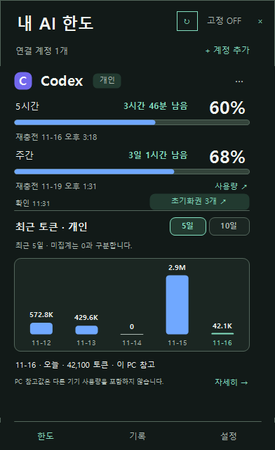
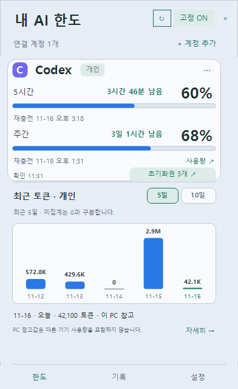
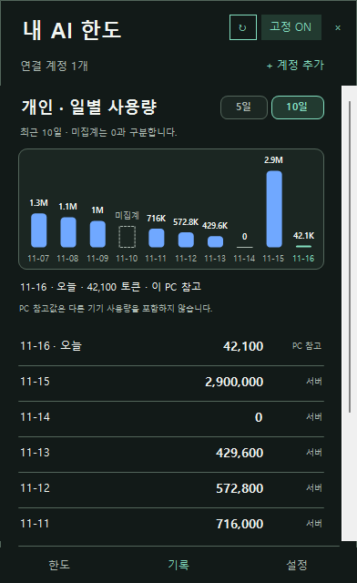

# 내 AI 한도 · Windows

Codex 5시간·주간 한도와 최근 일별 토큰을 보여주는 작은 Windows 위젯입니다. OpenAI 공식 앱이 아닌 개인 제작 무료 도구입니다.

[개인정보 처리방침](PRIVACY.md) · [계정 해제·자료 삭제](DATA-DELETION.md)

## 설치와 사용

[최신 설치 파일](https://github.com/peter0153/token-usage-widget/releases/latest)에서 Windows ZIP을 받고 **압축을 모두 푼 다음 `설치.cmd`를 실행**하세요. 계정은 각자 공식 브라우저에서 연결합니다.

다운로드만 하면 자동 실행되지 않습니다. `설치.cmd`가 현재 사용자의 `%LOCALAPPDATA%\Programs\TeacherCodexUsageWidget`에 프로그램을 복사하고 바탕화면·시작 메뉴 바로가기를 만든 뒤 실행합니다. 설치가 끝나면 압축을 푼 폴더가 없어도 바로가기로 사용합니다. 압축 폴더의 EXE를 직접 실행할 수도 있지만 자동 업데이트를 이용하려면 위 방법으로 설치하세요. 받는 분은 GitHub 계정이 필요하지 않습니다.

- 큰 위젯과 작업표시줄 미니바를 별도로 표시하고 숨길 수 있습니다.
- X는 큰 창만 숨깁니다. 완전 종료는 트레이 우클릭 → 앱 종료입니다.
- 미니바 왼쪽 가장자리를 드래그하거나 우클릭 → 미니바 크기로 너비를 바꿉니다.
- 작은 미니바는 %와 남은 시간, 넓은 미니바는 초기화 시각도 표시합니다.
- 첫 화면 아래에서 최근 **5일/10일** 막대그래프를 보고, 기록 탭에서 날짜별 정확한 값을 확인합니다.
- 서버 집계를 우선하며 없는 날짜는 이 PC 참고값으로 구분합니다. 다른 기기의 PC 기록은 포함하지 않습니다. 미집계를 0으로 표시하지 않습니다.
- 초기화권은 계정이 수량을 제공할 때만 표시합니다. 초기화권·사용량 링크로 공식 사용량 화면을 엽니다. 앱이 초기화권을 사용하지 않습니다. 브라우저 로그인은 별도입니다.
- 새 설치의 기본 테마는 다크입니다. 설정에서 테마와 자동 시작·업데이트 알림을 선택합니다.
- 라이트는 회청색 배경과 밝은 둥근 카드로 흰 브라우저 화면과 구분합니다. 미니바의 둥근 테두리 바깥은 투명합니다.

현재 사용자 폴더에 설치하며 관리자 권한을 요구하지 않습니다. 공인 Windows 코드 서명은 적용하지 않아 PC 보안 정책에 따른 경고가 남을 수 있습니다. 내부 업데이트 검증 서명은 Windows 게시자 인증과 다른 기능입니다.

## 개인정보와 계정 보관

**[개인정보 처리방침](PRIVACY.md) · [계정 연결 해제·데이터 삭제 안내](DATA-DELETION.md)**

- 위젯은 계정 인증정보·사용량·PC 로그를 **제작자의 수집 서버로 자동 전송하는 기능을 두지 않습니다.**
- 비밀번호는 OpenAI 공식 로그인 화면에 입력합니다. 로그인 유지용 **인증 토큰과 사용량 캐시는 사용자 PC에 저장**하며, 현재 독립 로그인 인증 파일에 위젯이 별도 암호화를 추가하지 않습니다.
- 로그인·사용량 조회에는 OpenAI, 업데이트 확인·다운로드에는 GitHub와의 통신이 필요합니다. 외부 서비스의 접속 정보 처리는 각 제공자 정책도 적용됩니다.
- **계정 연결 해제만으로 모든 파일이 삭제되지는 않습니다.** 인증정보가 포함될 수 있는 캐시·복구 백업과 삭제 방법을 위 안내에서 확인하세요.
- `auth.json`, 계정 폴더, `.codex`, 백업 폴더 전체를 문의에 첨부하지 마세요. 사용자가 직접 보낸 문의 자료는 자동 수집과 별개입니다.
- 운영·개인정보 문의 담당: **피터0153** · **[sklwi2913@gmail.com](mailto:sklwi2913@gmail.com)**. 일반 버그·기능 문의는 [Issues](https://github.com/peter0153/token-usage-widget/issues)를 이용할 수 있습니다. 공개 이슈에 개인정보를 올리지 마세요.

## 화면 예시

아래는 **2.1.1 화면과 실제 미니바 그리기 코드로 만든 예시**입니다. 수치·계정 별칭은 기능 설명을 위한 합성 데이터이며 개인 계정 정보가 아닙니다. 이미지를 누르면 크게 볼 수 있습니다.

### 큰 위젯 · 다크 / 라이트

5시간·주간 한도의 남은 비율과 초기화까지 남은 시간, 초기화권 수량, 최근 일별 토큰 그래프를 한 화면에서 확인합니다. **다크가 새 설치의 기본값**이며, 라이트는 회청색 바탕과 밝은 둥근 카드로 구성되어 있습니다.

| 다크 · 기본 테마 | 라이트 · 회청색 배경 |
| --- | --- |
| <a href="docs/screenshots/widget-dark.png"></a> | <a href="docs/screenshots/light-theme.png"></a> |

### 작업표시줄 미니바 · 최대로 넓힌 모습

아래 두 화면은 **최대 너비 360 기준**입니다. Windows 배율에 따라 실제 픽셀 크기는 달라지며, 글씨가 잘 보이도록 예시는 2배 해상도로 렌더링했습니다. **남은 %와 그래프 → 시계 아이콘 옆 초기화 시각 → 초기화까지 남은 시간** 순서입니다. 미니바는 작업표시줄 안에 표시되며, 둥근 모서리 바깥은 투명합니다.

**다크**

[](docs/screenshots/taskbar-expanded-dark.png)

**라이트**

[](docs/screenshots/taskbar-expanded-light.png)

**크기와 테마 바꾸기**

- **미니바 왼쪽 가장자리를 마우스로 끌면** 너비를 연속으로 줄이거나 늘릴 수 있습니다. 최대 너비는 끝까지 늘려 선택합니다.
- **우클릭 → 미니바 크기**에서 작게·보통·자세히 중 선택하거나, 설정의 너비 슬라이더로 조절할 수도 있습니다.
- **우클릭 → 테마**에서 다크·라이트·시스템을 선택합니다. 마우스를 올리면 테두리가 반응합니다.
- 큰 창과 미니바는 독립적으로 켜고 끌 수 있습니다. 미니바를 두 번 누르면 큰 창이 열리고, 우클릭하면 표시·계정·자동 시작·업데이트 메뉴가 열립니다.

### 공간이 좁을 때 · 작게 줄인 모습

너비를 줄이면 **남은 %와 남은 시간** 위주로 간단하게 표시합니다. 아래는 작은 크기 160의 예시입니다.

| 다크 · 작게 | 라이트 · 작게 |
| --- | --- |
| [](docs/screenshots/taskbar-small-dark.png) | [](docs/screenshots/taskbar-small-light.png) |

<details>
<summary><strong>일별 토큰 기록 · 10일 화면 펼쳐 보기</strong></summary>

첫 화면과 기록 탭에서 **5일/10일** 범위를 선택합니다. 기록 탭에서는 막대그래프와 날짜별 수치를 확인하고 아래로 스크롤해 더 볼 수 있습니다. 서버 집계·이 PC 참고값·미집계를 구분하며, 미집계를 0으로 표시하지 않습니다.

[](docs/screenshots/history-ten-days.png)

</details>

## 빌드

Windows x64의 .NET Framework C# 컴파일러와 PowerShell을 사용합니다.

```powershell
.\distribution-src\download-runtime.ps1
.\distribution-src\test-features.ps1
.\distribution-src\test-transactions.ps1
.\distribution-src\build.ps1
```

고정된 OpenAI Codex app-server 0.163.0의 해시를 확인하며 런타임 LICENSE/NOTICE를 함께 배포합니다. 대화나 모델 요청을 만들지 않습니다. Claude 연결은 아직 지원하지 않습니다.

## 유지보수자의 새 버전 배포

1. `distribution-src/version.txt`의 버전을 올리고 변경한 소스를 main에 올립니다. 이미 게시된 버전의 설치 파일은 덮어쓰지 않습니다.
2. GitHub Actions가 검사·빌드하여 공개 사전 배포 ZIP을 생성합니다. 이 단계에는 비밀 서명 키가 없습니다.
3. 제작자 PC로 그 ZIP을 내려받아 아래 명령으로 검증하고 서명합니다. 기존 비공개 키는 제작자 PC의 `.release-signing/update-key.xml`에 보관하며 저장소에 올리지 않습니다.

```powershell
.\distribution-src\sign-published.ps1 -Archive '다운로드한 TokenWidget-버전-win64.zip 경로'
```

4. 생성된 **공개용** `update.json`을 저장소의 `release/update.json`으로 올리고 커밋 메시지에 `[publish-manifest]`를 넣습니다.
5. Actions가 공개 키·해시·ZIP 구성·실행 파일 버전을 다시 확인한 뒤 서명 정보를 Release에 게시하고 정식 배포로 전환합니다.

앱은 최신 정식 Release를 확인해 알리고, 승인한 업데이트를 내려받아 검증·교체·재실행합니다. 새 버전 시작 실패는 이전 파일로 복원하고, 중간 종료는 바로가기로 다음 실행할 때 복구합니다. 설정과 계정은 실행 파일과 별도 보관합니다.

로그인 파일, 개인 설정·기록, 진단 로그, 비밀 키는 공개 저장소에 올리지 마세요. 소스는 MIT, 번들 Codex 런타임은 Apache-2.0입니다.
